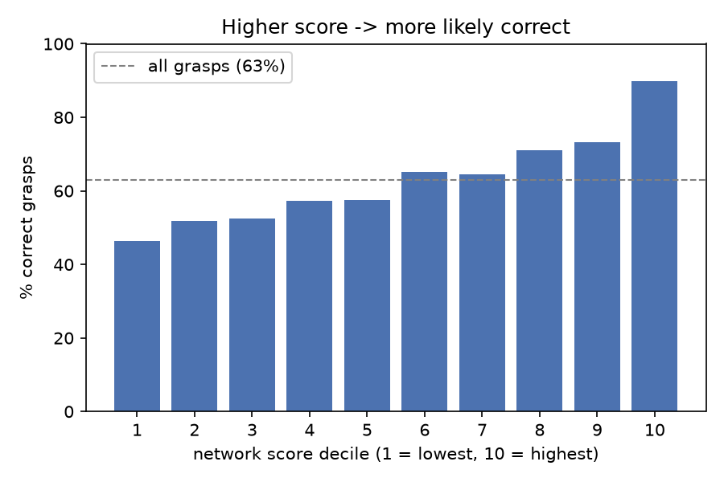
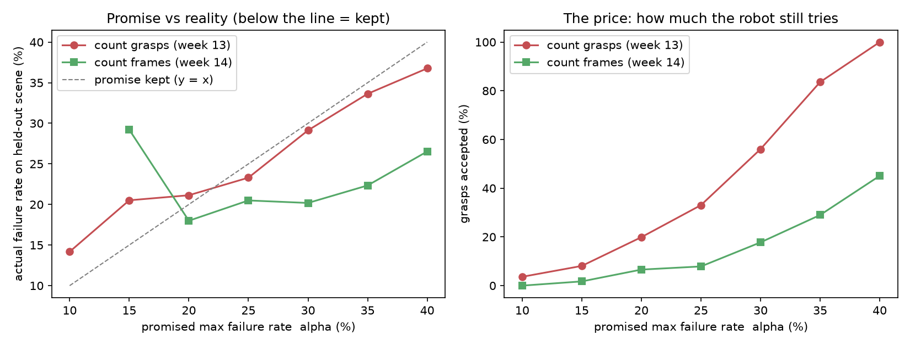

# ConfGrasp — knowing when *not* to grasp

**A calibration and abstention safety layer for any grasp detector. Give it scored grasps; it returns a threshold with a statistical promise — and tells you honestly when that promise breaks on new scenes.**

A grasp network gives every grasp a score, but the score has no meaning on its own: "0.4" does not tell a robot how often it will drop the object. ConfGrasp turns scores into a decision rule with a guarantee — *"of the grasps I accept, at most α% fail"* — and abstains on everything else, so uncertain picks can be routed to a person instead of attempted blindly.

This is the decision every production picking system has to make. Deployed systems hand off low-confidence picks to humans, and their accuracy drops when they move to a new site before recovering with new data. ConfGrasp studies exactly that failure mode: **does a calibrated promise survive scenes the calibration has never seen?** (Spoiler: naively, no.)

The layer is **detector-agnostic**: it only consumes `(grasp, score)` pairs. The current detector is GraspNet-baseline on GraspNet-1Billion scenes; it is the replaceable part. The calibration layer is the contribution.

>

---

## Results at a glance

Detector: pretrained GraspNet-baseline. Scenes: GraspNet-1Billion 100–104, leave-one-scene-out.

| | Accepted grasps | Failure rate (held-out scenes) | Promise broken |
|---|---|---|---|
| No calibration (try everything) | 100% | **37.1%** | – |
| Calibrated, α = 20%, counting grasps | 19.9% | 21.1% | 4 / 5 scenes |
| Calibrated, α = 20%, counting frames | 6.6% | **18.0%** | 1 / 5 scenes |
| Calibrated, α = 30%, counting frames | 17.8% | 20.2% | **0 / 5** scenes |

Key findings:

1. **The network score is informative.** Grasps in the top score decile are ~90% correct, in the bottom decile ~47% (Fig. 1).
2. **Naive calibration breaks on new scenes.** Calibrating on 4 scenes and testing on the 5th, the 20% promise was violated on 4 of 5 scenes (worst: 32.6% on scene 102). This is the cross-scene shift that hits deployed systems at every new site.
3. **Why:** the guarantee assumes independent samples, but grasps from the same camera frame are near-copies. Counting ~44 frames instead of ~4,500 grasps as evidence makes the bound honest — violations drop to 1/5 (α = 20%) and 0/5 (α = 30%) — at the price of abstaining more (Fig. 2).
4. **A better detector doesn't make this go away** — miscalibration under scene shift is a property of the evaluation, not of one 2020 model. Testing a second, stronger detector through the same layer is the next step (see below).


*Fig. 1 — % correct grasps per network-score decile (5,657 grasps, 55 frames, 5 scenes).*


*Fig. 2 — Left: promised vs actual failure rate on the held-out scene (below the dashed line = promise kept). Right: share of grasps the robot still attempts.*

---

## Pipeline

```
depth image ──► point cloud ──► fixed workspace crop ──► any grasp detector
                                                         (here: GraspNet-baseline, pretrained)
                                                              │
                                              grasps + detector score
                                                              │
                         collision filter ──► ConfGrasp threshold ──► ACCEPT  /  ABSTAIN
                                                                        │           │
                                                                     attempt     hand off
```

The dashed box is the only detector-specific part. Everything below the score consumes `(grasp, score, outcome)` triples and works unchanged with any scorer.

| Step | What | File |
|---|---|---|
| Answer key | Rebuilt GraspNet's ground-truth grasps from the raw label files (object frame → camera frame, 300 views × 12 angles, object + scene collisions). Verified against the official API: 0.00 mm / ≤ 0.02° error. | `11_Real_GraspNet_labels.py` |
| Predictions | Pretrained GraspNet-baseline (Kinect checkpoint) on 55 frames (scenes 100–104, every 25th frame), run on a Colab T4. Fixed crop, chosen once on scene 100. | `week12_graspnet.ipynb` |
| Labelling | A prediction is *correct* if a valid ground-truth grasp (friction ≤ 0.2, collision-free) lies within 1 cm and 30° (180° flip around the approach axis counts as the same grasp). | `12d_label_many.py` |
| Calibration | Clopper-Pearson upper bound on the failure rate; pick the loosest score threshold whose bound ≤ α. Leave-one-scene-out evaluation. | `13_calibrate_real.py` |
| Honest evidence | Same, but the evidence is counted in frames instead of grasps. | `14_calibrate_frames.py` |
| Figures | | `15_make_figures.py` |

Earlier steps (weeks 1–8: point clouds, camera model, grasp geometry, partial views, a small PyTorch grasp scorer, synthetic conformal experiments, a real phone scan) are in `01_…` to `09_…`.

---

## Metrics that matter in deployment

Production picking systems are judged on more than accuracy. The evaluation here reports, and the real-robot stage will report:

- **Success rate on attempted picks** (the promise: ≤ α% failures among accepts)
- **Attempt rate** — how often the robot acts at all (abstaining on everything is a useless guarantee)
- **Interventions per 100 picks** — each abstention is a human handoff; it has a cost, but a smaller one than a dropped item

## Limitations (honest list)

- **Correctness is a proxy.** The 1 cm / 30° nearest-label rule is more lenient than GraspNet's official physics-based evaluation (it ignores width and depth). Numbers here are good for *comparing* methods, not for comparing with published AP.
- **Small evaluation:** 5 scenes, 55 frames. Scene-to-scene variation dominates.
- **"Count frames" is an approximation** (an effective-sample-size correction), not an exact proof. Frames from the same scene are still correlated.
- **One detector so far.** GraspNet-baseline is a 2020 model; newer detectors score much higher. The layer is independent of the detector, but that claim is only demonstrated once a second detector runs through it.

## Next

- [ ] **Second detector** (RNGNet / HGGD) through the same layer, same 55 frames: does calibration also break on new scenes with a stronger model?
- [ ] **Real SO-101 arm** (in progress — servos configured, parts printing): calibrate on real pick attempts, where success is measured by the gripper (position + current); show the promise breaking on new scenes and recovering after recalibration.
- [ ] Calibrate on more scenes.
- [ ] **ROS 2 node** (C++, ONNX Runtime) for accept/abstain at run time, publishing accepted grasps green and abstained red in RViz.
- [ ] Stretch: failure detection for a fine-tuned vision-language-action policy.

## Run it

```bash
# laptop (Windows, Python 3.12): graspnetAPI, open3d, numpy, scipy, matplotlib
python 12c0_extract_scenes.py      # pull needed frames from test_seen.zip
python 12c_pack_frames.py          # -> frames_pack.zip (upload to Google Drive)
# Colab (T4 GPU): open week12_graspnet.ipynb -> Run all -> preds_pack.zip
python 12d_label_many.py           # -> week12_calib.npz
python 13_calibrate_real.py
python 14_calibrate_frames.py
python 15_make_figures.py
```

Data (not in this repo): [GraspNet-1Billion](https://graspnet.net/datasets.html) — `test_seen.zip`, `grasp_label.zip`, `collision_label.zip`.

## References

- Fang et al., *GraspNet-1Billion: A Large-Scale Benchmark for General Object Grasping*, CVPR 2020. Code: [graspnet-baseline](https://github.com/graspnet/graspnet-baseline), [graspnetAPI](https://github.com/graspnet/graspnetAPI).
- Clopper & Pearson, *The use of confidence or fiducial limits illustrated in the case of the binomial*, Biometrika 1934.
- Angelopoulos & Bates, *A Gentle Introduction to Conformal Prediction and Distribution-Free Uncertainty Quantification*, 2021.

---
*Author: Yegane Bagheri 
